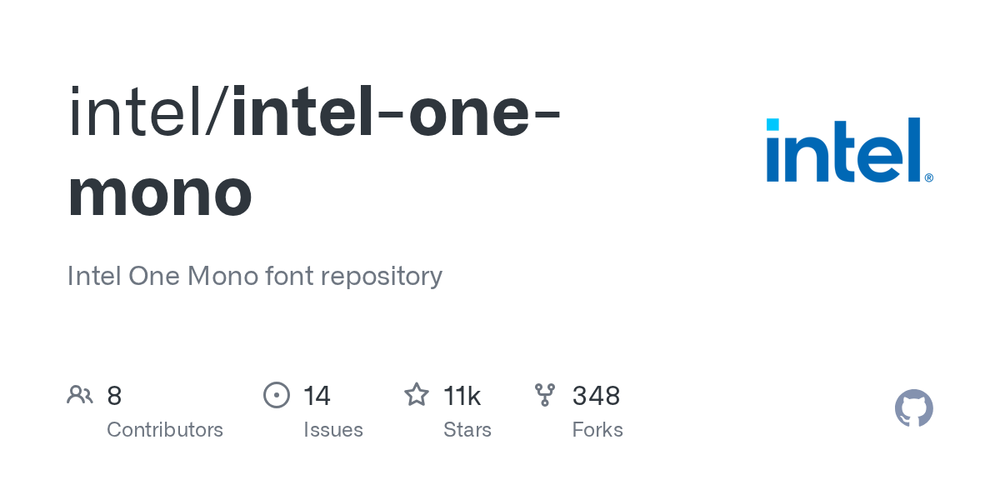
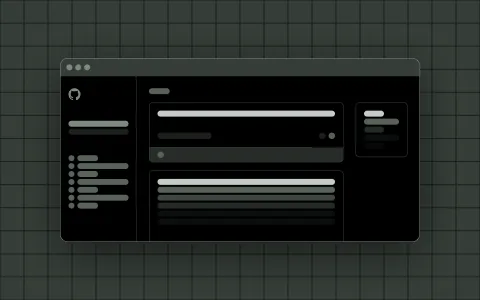

# Design/UI inspiration — 2026-11-26

> Draft only. Check the source, add your own experience or specific takeaway, and confirm image rights before publishing.

**Topic:** Intel One Mono font
**Published:** 2026-11-26T10:11:01+00:00
**Source:** Hacker News
**Article:** https://github.com/intel/intel-one-mono
**Hacker News:** 329 points / 193 comments

## Suggested post text

Design inspiration: Intel One Mono font

Open the source for the details and add your own specific takeaway before sharing.

A useful reminder to look at the details behind the visual result—not just the screenshot.

Read the original: https://github.com/intel/intel-one-mono

#UIDesign #WebDesign #UX

## Images

Image file: drafts/images/2026-11-26-design-1.png

Image file: drafts/images/2026-11-26-design-2.webp

Image file: drafts/images/2026-11-26-design-3.webp

> Up to three images were collected from RSS or article metadata/content. Check license/attribution. The Markdown images are a review preview; LinkedIn needs separate media upload when publishing.
