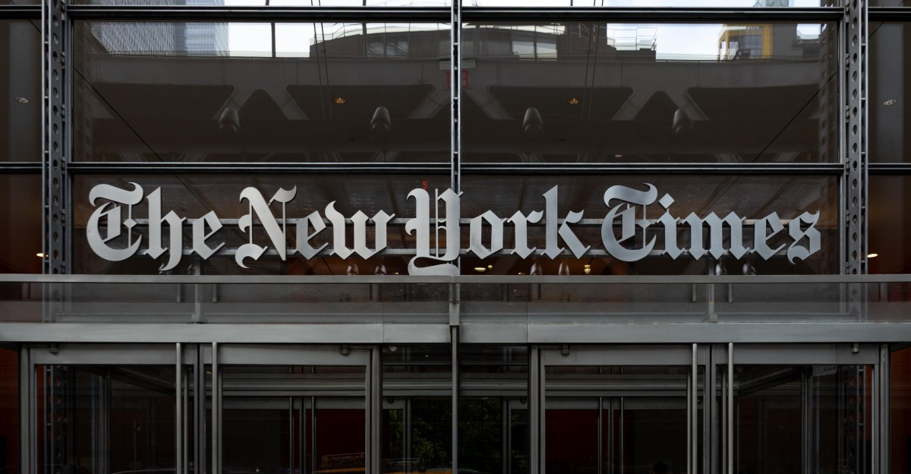

# LinkedIn Draft — 2026-11-26

> Review the facts and add your own specific takeaway before publishing. This draft is assembled from RSS data; it is not AI fact-checking or original analysis.

**Topic:** The New York Times warns photographers not to update Photoshop over AI features
**Published:** 2026-11-25T21:18:02+00:00
**Source:** Hacker News
**Article:** https://www.theverge.com/ai-artificial-intelligence/1041227/the-new-york-times-warns-photographers-not-to-update-photoshop-over-ai-features
**Hacker News engagement:** 536 points, 455 comments

## Suggested post text

Interesting tech story: The New York Times warns photographers not to update Photoshop over AI features

https://archive.ph/pcUgy

The part worth looking into is what this changes for the people using it—not just the announcement itself.

I’d want to understand who benefits, what trade-offs it introduces, and how it performs in real use.

What’s your take?

Read the original: https://www.theverge.com/ai-artificial-intelligence/1041227/the-new-york-times-warns-photographers-not-to-update-photoshop-over-ai-features

#Technology #SoftwareDevelopment #TechNews

## Image to attach

Image file: `drafts/images/article-image-2026-11-26.jpg`

> This image is downloaded from the article's RSS media or social preview metadata. Check usage rights and attribution before publishing. LinkedIn publishing will need the image uploaded as media; a Markdown image alone does not publish an attachment.
