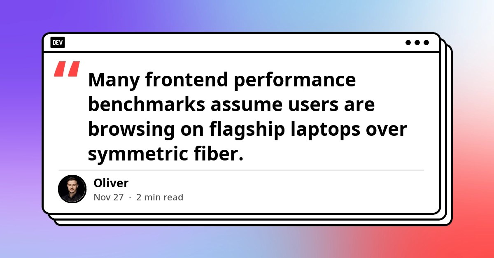

# LinkedIn Draft — 2026-11-27

> One-topic daily draft. Verify the article, edit the opinion to match your own experience, and check image rights before publishing.

**Niche:** Modern CSS & Styling
**Topic:** Designing Accessible, Low-Bandwidth Search UIs in TypeScript and Modern CSS
**Published:** 2026-11-27T09:40:59+00:00
**Source:** DEV — CSS
**Article:** https://dev.to/oliver9870/designing-accessible-low-bandwidth-search-uis-in-typescript-and-modern-css-411a

## Suggested post

Designing Accessible, Low-Bandwidth Search UIs in TypeScript and Modern CSS

Many frontend performance benchmarks assume users are browsing on flagship laptops over symmetric fiber. In reality, people searching for regional opportunities—such as listings on Canadian community and regional career portals —frequently rely on mid-tier mobile devices, screen readers, or throttled rural cellular connections

Topic: Modern CSS & Styling.

The practical angle to look for:
• What changed from the previous approach?
• Where could it help, and what trade-off should you test?

Would you try this in a real project?

Source: https://dev.to/oliver9870/designing-accessible-low-bandwidth-search-uis-in-typescript-and-modern-css-411a

#CSS #WebDesign #Frontend

## Custom article graphics

Image file: drafts/images/2026-11-27-linkedin-card-1.jpg

> The headline is placed in a separate solid panel below the article image to prevent text overlap. This is a designed card, not AI-generated artwork.

## Original article images

> Original images are included as references. Check publisher licensing and reuse rights before posting.

Source image: https://media2.dev.to/dynamic/image/width=1200,height=627,fit=cover,gravity=auto,format=auto/https%3A%2F%2Fdev-to-uploads.s3.us-east-2.amazonaws.com%2Fuploads%2Farticles%2Ff0pofgbr7lbsu2khdkfm.png

Source image: https://media2.dev.to/dynamic/image/quality=100/https://dev-to-uploads.s3.amazonaws.com/uploads/logos/resized_logo_UQww2soKuUsjaOGNB38o.png

