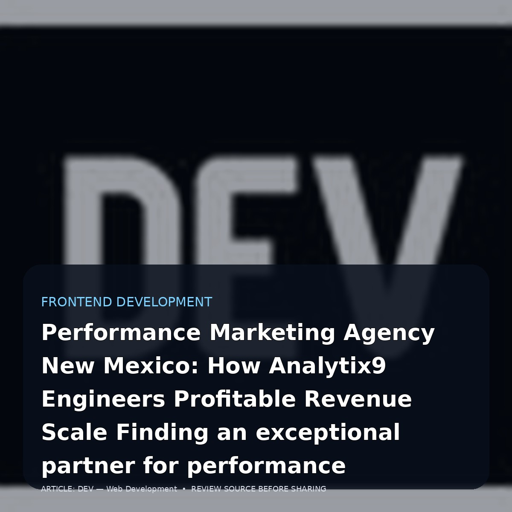

# LinkedIn Draft — 2026-11-27

> One-topic daily draft. Verify the article, edit the opinion to match your own experience, and check image rights before publishing.

**Niche:** Frontend Development
**Topic:** Performance Marketing Agency New Mexico: How Analytix9 Engineers Profitable Revenue Scale
**Published:** 2026-11-27T05:53:18+00:00
**Source:** DEV — Web Development
**Article:** https://dev.to/a9leads_1f0037dca685ef4af/performance-marketing-agency-new-mexico-how-analytix9-engineers-profitable-revenue-scale-2091

## Suggested post

Performance Marketing Agency New Mexico: How Analytix9 Engineers Profitable Revenue Scale

Performance Marketing Agency New Mexico: How Analytix9 Engineers Profitable Revenue Scale Finding an exceptional partner for performance marketing agency new mexico is one of the highest-use growth decisions a business leader can make. Yet for most CEOs, CMOs, and e-commerce directors, past experiences with digital marketing agencies have been frustrating: pretty monthly PDF reports, rising costs per click, and an endless stream of excuses about "market saturation." At Analytix9 , we operate under a completely different standard. We don't view paid search as an ad-buying exercise—we run it as an engineering discipline where every dollar invested must directly produce measurable revenue, pipeline value, and gross profit. Why Most Campaigns Struggle with Performance Marketing Agency New Mexico When our senior media buyers conduct a diagnostic audit of accounts previously managed by generalist agencies, we consistently find the same three structural flaws: 1. Broad Match Bleed Without Defensive Negative Buffers Google's automated match algorithms are engineered to maximize ad spend volu

Topic: Frontend Development.

What caught my attention is the specific idea in this article—not just the headline.
I’d test or evaluate it against a real project before adopting it. What would you try first?

Read the original: https://dev.to/a9leads_1f0037dca685ef4af/performance-marketing-agency-new-mexico-how-analytix9-engineers-profitable-revenue-scale-2091

#Frontend #WebDevelopment #JavaScript

## Custom article graphics

Image file: drafts/images/2026-11-27-linkedin-card-1.jpg

Image file: drafts/images/2026-11-27-linkedin-card-2.jpg

> These are designed editorial cards made from article imagery and its headline/context. They are not AI-generated illustrations. Confirm image reuse rights and attribution before posting.
