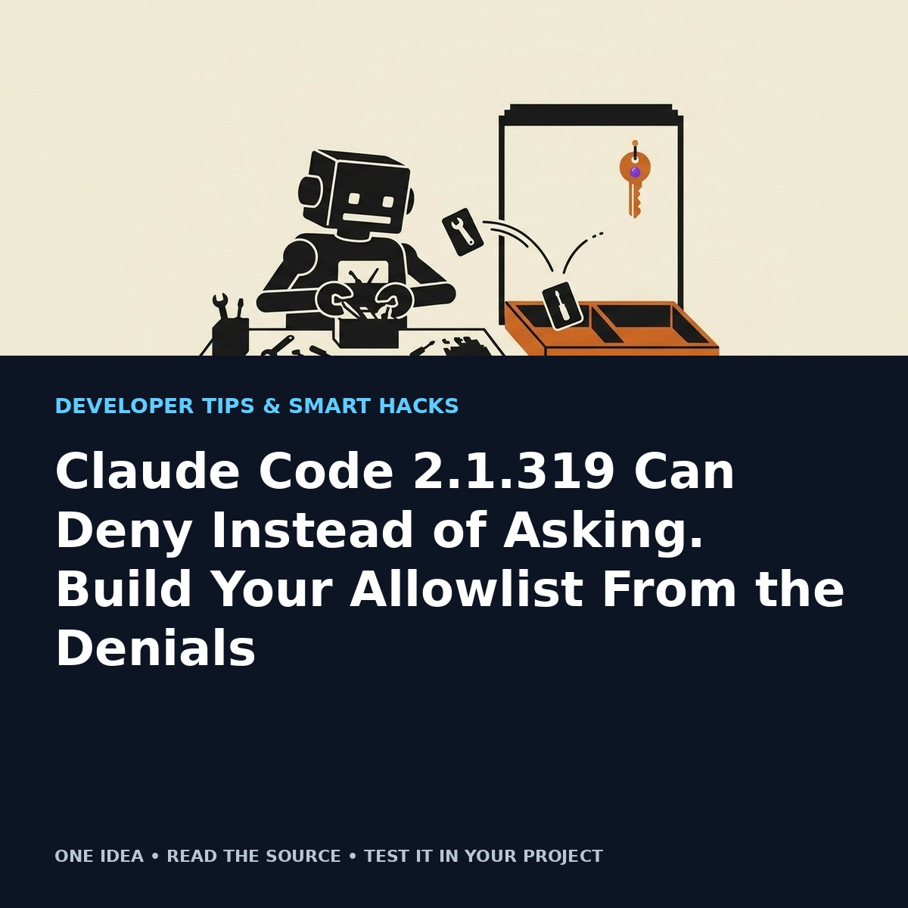
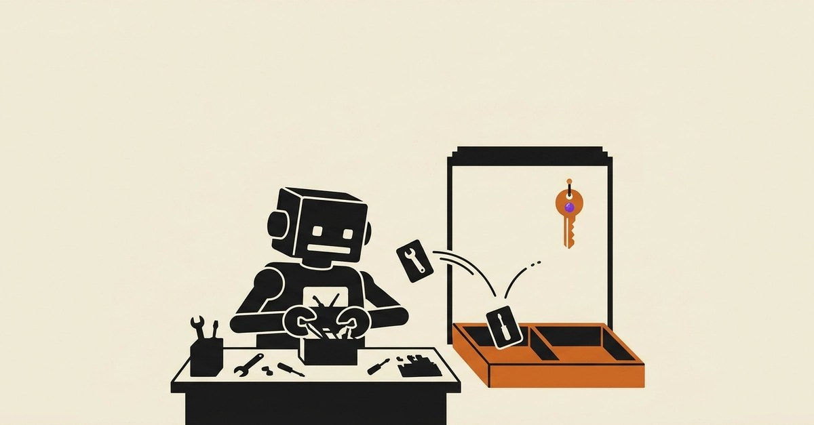

# LinkedIn Draft — 2026-11-28

> One-topic daily draft. Verify the article, edit the opinion to match your own experience, and check image rights before publishing.

**Niche:** Developer Tips & Smart Hacks
**Topic:** Claude Code 2.1.319 Can Deny Instead of Asking. Build Your Allowlist From the Denials
**Published:** 2026-11-28T12:01:42+00:00
**Source:** DEV — Tutorial
**Article:** https://dev.to/gabrielanhaia/claude-code-21319-can-deny-instead-of-asking-build-your-allowlist-from-the-denials-1f8g

## Suggested post

Claude Code 2.1.319 Can Deny Instead of Asking. Build Your Allowlist From the Denials

Book: Prompt Engineering Pocket Guide Also by me: Thinking in Go (2-book series) — Complete Guide to Go Programming + Hexagonal Architecture in Go My project: Hermes IDE | GitHub — an IDE for developers who ship with Claude Code and other AI coding tools Me: xgabriel.com | GitHub Claude Code 2.1.319, released on November 6, 2026, changes what a session does when it reaches a permission prompt and you're away from

Topic: Developer Tips & Smart Hacks.

The practical angle to look for:
• What changed from the previous approach?
• Where could it help, and what trade-off should you test?

Would you try this in a real project?

Source: https://dev.to/gabrielanhaia/claude-code-21319-can-deny-instead-of-asking-build-your-allowlist-from-the-denials-1f8g

#CodingTips #DeveloperProductivity #Programming

## Custom article graphics

Image file: drafts/images/2026-11-28-linkedin-card-1.jpg

> The headline is placed in a separate solid panel below the article image to prevent text overlap. This is a designed card, not AI-generated artwork.

## Original article images

> Original images are included as references. Check publisher licensing and reuse rights before posting.

Source image: https://media2.dev.to/dynamic/image/width=1200,height=627,fit=cover,gravity=auto,format=auto/https%3A%2F%2Fdev-to-uploads.s3.us-east-2.amazonaws.com%2Fuploads%2Farticles%2F7zbzb44heeqmd5a87ntp.jpg

Source image: https://media2.dev.to/dynamic/image/quality=100/https://dev-to-uploads.s3.amazonaws.com/uploads/logos/resized_logo_UQww2soKuUsjaOGNB38o.png

