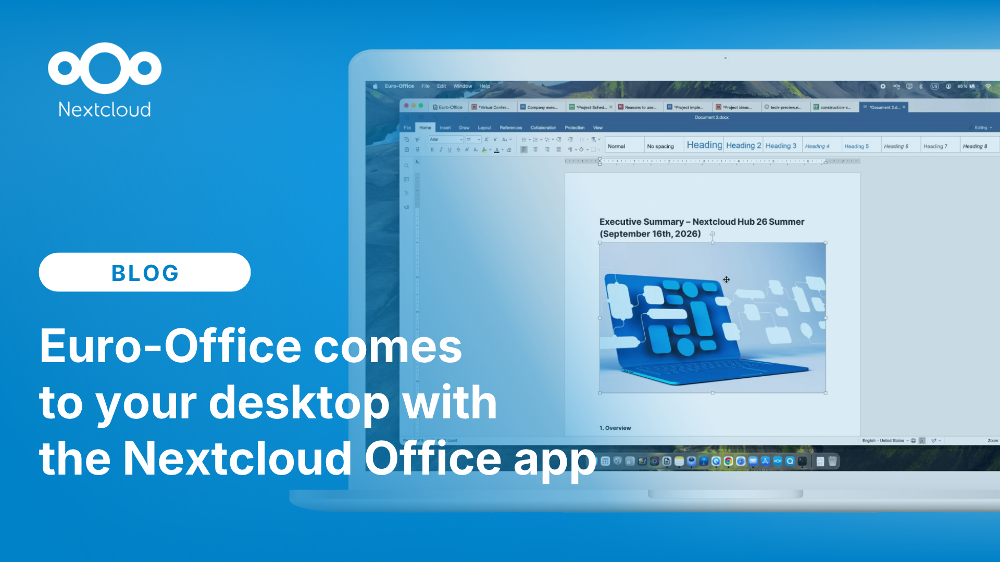

# Programming tip or tutorial — 2026-11-26

> Draft only. Check the source, add your own experience or specific takeaway, and confirm image rights before publishing.

**Topic:** Euro-Office comes to your desktop with the Nextcloud Office Desktop app
**Published:** 2026-11-26T11:50:49+00:00
**Source:** Hacker News
**Article:** https://nextcloud.com/blog/euro-office-comes-to-your-desktop-with-the-nextcloud-office-desktop-app/
**Hacker News:** 320 points / 131 comments

## Suggested post text

Developer bookmark: Euro-Office comes to your desktop with the Nextcloud Office Desktop app

Open the source for the details and add your own specific takeaway before sharing.

Worth testing in a small project and keeping only if it improves your workflow.

Read the original: https://nextcloud.com/blog/euro-office-comes-to-your-desktop-with-the-nextcloud-office-desktop-app/

#Programming #WebDevelopment #CodingTips

## Images

Image file: drafts/images/2026-11-26-programming-1.png

Image file: drafts/images/2026-11-26-programming-3.png

> Up to three images were collected from RSS or article metadata/content. Check license/attribution. The Markdown images are a review preview; LinkedIn needs separate media upload when publishing.
